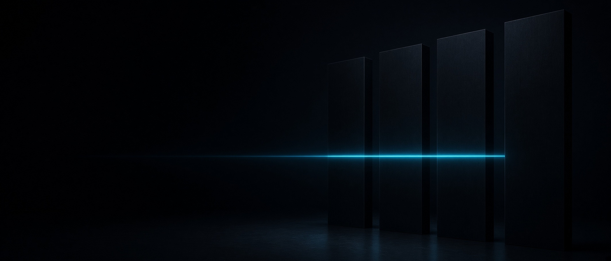

<h3 align="center">A template that compiles before it promises.</h3>

<p align="center">
  <b>Give an agent the link. It names the project, keeps this repo as upstream, and does not push.</b><br>
  One Rust core you own · three start profiles · a shell that draws only what is connected
</p>

<p align="center">
  <a href="https://well-ux.com"><b>well-ux.com</b></a> &nbsp;·&nbsp;
  <a href="#start">Start</a> &nbsp;·&nbsp;
  <a href="#give-it-to-an-agent">Agent</a> &nbsp;·&nbsp;
  <a href="#architecture">Architecture</a> &nbsp;·&nbsp;
  <a href="#access">Access</a> &nbsp;·&nbsp;
  <a href="https://github.com/Wellux/wellux-agent-template/actions/workflows/ci.yml">CI</a>
</p>

<picture>
  <source media="(prefers-color-scheme: dark)" srcset=".github/assets/divider-dunkel.svg">
  
</picture>

Most agent stacks rent you a cloud and call it a platform. This is the block you own. The policy lives in the core. The page only renders it. What is code, what is an interface, and what is still a recipe are labeled apart, so the first hour is not archaeology.

## Start

Rust 1.80 or newer. Nothing else is required to prove the core.

<table>
  <tr>
    <td width="58%" valign="top">

```bash
git clone https://github.com/Wellux/wellux-agent-template.git
cd wellux-agent-template
make project NAME=my-agent REPO=https://github.com/OWNER/my-agent
make test
make personal    # or: make business / make desktop
make shell
```

| Profile | You are building | Command |
|---------|------------------|---------|
| Personal | A local companion with a second brain | `make personal` |
| Business | Traces, MCP, a MicroVM for untrusted code | `make business` |
| Desktop | Computer use, with a human in the loop | `make desktop` |

    </td>
    <td width="42%" valign="top">
      <picture>
        <source media="(prefers-color-scheme: dark)" srcset=".github/assets/terminal-dunkel.svg">
        
      </picture>
    </td>
  </tr>
</table>

`make test` is the gate. If it is red, stop. Engram, Quicksand and API keys are optional until the profile you pick asks for them. The written path is [`docs/START.md`](docs/START.md).

## Give it to an agent

Paste this. Replace the name and the destination. The destination is an empty repository you own, not this template. The agent follows [`AGENTS.md`](AGENTS.md).

```text
Create a project from this template. Follow AGENTS.md.

Template: https://github.com/Wellux/wellux-agent-template
Name: my-agent
Destination: https://github.com/OWNER/my-agent

Do not push. Do not commit .env. Stop if make test fails.
```

`make project` writes `project.toml`, stamps the first skill, points `origin` at your repo and keeps this template as `upstream`. It refuses to run twice. It refuses this template's own URL as a destination. Full walkthrough: [`docs/PROJECT.md`](docs/PROJECT.md).

## Architecture

<picture>
  <source media="(prefers-color-scheme: dark)" srcset=".github/assets/arch-dunkel.svg">
  
</picture>

The line moves when the viewer allows it. If it doesn't, the labels still read in order: shell, core, doors, edge.

## What is actually in the box

| Piece | Where | State |
|-------|--------|--------|
| Skills loader | `crates/agent-core/src/skills.rs` | Loads `SKILL.md` as an index, full text on demand |
| Guardrails | `guardrails.rs` | Redacts email and `sk-` / `xai-` secrets. Tested |
| Provider router | `providers.rs` | OpenAI, Anthropic, Gemini, xAI, **OrcaRouter**, Ollama. No network calls |
| Sandbox choice | `sandbox.rs` | WASM, MicroVM, or Quicksand. Tested |
| Quicksand bridge | `quicksand_bridge.rs` | Interface. Needs the Python package to run |
| Sessions | `session_service.rs` | In-process stand-in named for a later libSQL swap |
| OpenTelemetry | `telemetry.rs` | Hook. Starts an exporter only when you add one |
| Engram | [`SECOND_BRAIN.md`](SECOND_BRAIN.md) | Install recipe plus tool names in the core |
| Base UI | `ui/`, `crates/shell` | `make shell` draws cards from `/api/surface`. Replace `ui/` to reskin |
| Svelte / Leptos / Tauri | [`LIVEUI.md`](LIVEUI.md) | Optional. Not required to run |
| CI | `.github/workflows/ci.yml` | `fmt`, tests, all three profiles |
| Access boundary | `access.rs`, [`docs/ACCESS.md`](docs/ACCESS.md) | Tested. Secrets that must not reach the browser |

OrcaRouter base URL, when you wire a client: `https://api.orcarouter.ai/v1`.

## Access

<picture>
  <source media="(prefers-color-scheme: dark)" srcset=".github/assets/access-dunkel.svg">
  
</picture>

Login, payment, and the model are separate doors.

- **Supabase** — email and OAuth (PKCE). Publishable key in the browser. Service role on the server. RLS on every table.
- **PayPal** — Orders API v2. The server sets the amount, creates the order, captures it, and verifies the webhook. The button only carries the client id.
- **OpenAI** — Continue with ChatGPT is OAuth plus PKCE against `auth.openai.com`. Plan usage counts only when the scope `chatgpt.tokens.use.direct` was actually granted. That login is not an API key. The live API receives a short-lived secret. `OPENAI_API_KEY` stays on the server.

The calls are in the core and covered by tests: `pkce_s256`, `redirect_allowed`, `paypal_order`, `chatgpt_authorize_url`, `plan_usage_granted`, `browser_realtime_secret`. None of them open a socket. Setup order: [`docs/ACCESS.md`](docs/ACCESS.md).

`make shell` serves [`ui/`](ui) on your machine. The page draws one card per door from `/api/surface`. A door is locked until its keys are in `.env`. Replace `ui/` to change the look. The routes stay.

## Sandboxes

<picture>
  <source media="(prefers-color-scheme: dark)" srcset=".github/assets/sandbox-dunkel.svg">
  
</picture>

`SandboxManager::recommend` picks the smallest runtime that fits.

## How a project is built here

| | Principle | In practice |
|:--|:---|:---|
| 01 | **Mechanics deterministic, cognition flexible** | The core and the tests do the routine. The model does the thinking. |
| 02 | **Your data is yours** | Secrets stay in `.env`. The service role, the PayPal secret and the API key never enter `ui/`. |
| 03 | **The door draws itself** | `/api/surface` lists what is connected. The page does not invent a card. |
| 04 | **An agent gets a link, not a tour** | [`AGENTS.md`](AGENTS.md) is the whole procedure. It does not push. |
| 05 | **A red test is a stop sign** | `make test` needs no keys. Do not continue past it. |

## Map

```text
AGENTS.md             what an agent runs when handed the GitHub link
crates/agent-core     shared core and tests
crates/shell          local UI, loopback only
ui/                   the base interface, replaceable
project.toml          the project name, set once
docs/PROJECT.md       the walkthrough
docs/MAP.md           which file owns which promise
```

## Not built yet

Each one docks onto a seam that already exists. Notes in [`docs/NEXT.md`](docs/NEXT.md).

1. **Tauri shell as a crate** — chat, streaming, the approval dialog.
2. **One `UiEvent`** — so Svelte and Leptos cannot drift.
3. **Doctor that talks to Engram** — a handshake, not only "binary on PATH".
4. **Approval queue** — computer use already flags itself. The queue is the missing piece.
5. **Traces without a collector** — the last twenty spans, locally.
6. **Bundle id** — `make project` names the checkout. A desktop bundle id comes when that crate exists.
7. **`sandbox.toml`** — image and memory in one file.
8. **Signed skills** — the loader refuses a file that is not on the trust list.
9. **Ten golden tasks** — still offline, still in CI.
10. **One public product** — a companion repo that uses only this template.

## License

MIT OR Apache-2.0. Pick either. See `LICENSE-MIT` and `LICENSE-APACHE`.

<p align="center"><sub>Built by <a href="https://github.com/Wellux">Marco Mengele · Wellux</a> · One block at a time.</sub></p>
