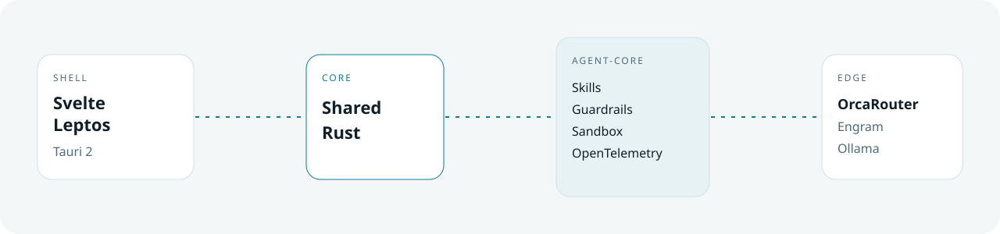

<picture>
  <source media="(prefers-color-scheme: dark)" srcset=".github/assets/header-dunkel.svg">
  
</picture>

<p align="center">
  
  
  
</p>

<h3 align="center">Wellux — the agent-native starter</h3>

<p align="center">
  A project template that compiles before it promises.<br>
  Shared Rust core · Engram second brain · Hermes-style skills · Guardrails · OpenTelemetry · Native VMs
</p>

<p align="center">
  <a href="https://well-ux.com"><b>well-ux.com</b></a> &nbsp;·&nbsp;
  <a href="#start-in-60-seconds">60-second start</a> &nbsp;·&nbsp;
  <a href="#architecture">Architecture</a> &nbsp;·&nbsp;
  <a href="#ten-next-moves">Ten next moves</a>
</p>

---

## Why this exists

Most agent stacks rent you someone else's cloud and then call it a platform.
Wellux is the block you own: one Rust core, three start profiles, and a shell you can swap.

Local first. The policy lives in the core, not in a frontend. What is code, what is an interface, and what is still a recipe are labeled separately — so the first hour is not archaeology.

## Start in 60 seconds

You need Rust 1.80+. Engram, Quicksand and API keys are optional until the profile you pick asks for them.

```bash
git clone https://github.com/Wellux/wellux-agent-template.git
cd wellux-agent-template
cp .env.example .env
make doctor
make personal     # or: make business / make desktop
make test
```

| Profile | You are building | Command | Features |
|---------|------------------|---------|----------|
| Personal | A local companion with a second brain | `make personal` | `memory-engram` |
| Business | Traces, MCP, a MicroVM for untrusted code | `make business` | `otel,mcp,memory-engram,sandbox-microvm` |
| Desktop | Computer use, with a human in the loop | `make desktop` | `computer-use,sandbox-microvm,sandbox-quicksand,memory-engram` |

New skill, same shape every time:

```bash
make skill NAME=release-notes
```

Details: [`docs/START.md`](docs/START.md).

## Architecture

<picture>
  <source media="(prefers-color-scheme: dark)" srcset=".github/assets/arch-dunkel.svg">
  
</picture>

The shell is thin on purpose. Sessions, skills, guardrails and the provider table sit in `crates/agent-core`. Frontends should render events, not invent policy.

The connectors animate when the SVG is opened directly. If a viewer freezes motion, the labels still read in order: shell, core, agent, edge.

## What is actually in the box

| Piece | Where | State |
|-------|--------|--------|
| Skills loader | `crates/agent-core/src/skills.rs` | Loads `SKILL.md` as an index, full text on demand |
| Guardrails | `guardrails.rs` | Redacts email and `sk-` / `xai-` secrets. Tested |
| Provider router | `providers.rs` | OpenAI, Anthropic, Gemini, xAI, **OrcaRouter**, Ollama. No network calls |
| Sandbox choice | `sandbox.rs` | WASM, MicroVM, or Quicksand. Tested |
| Quicksand bridge | `quicksand_bridge.rs` | Interface. Needs the Python package to run |
| Sessions | `session_service.rs` | In-process stand-in named for a later libSQL swap |
| OpenTelemetry | `telemetry.rs` | Hook. Starts an exporter only when you add one |
| Engram | [`SECOND_BRAIN.md`](SECOND_BRAIN.md) | Install recipe plus tool names in the core |
| Svelte / Leptos / Tauri | [`LIVEUI.md`](LIVEUI.md) | Recipe. Not vendored, so the core stays UI-free |
| CI | `.github/workflows/ci.yml` | `fmt`, tests, all three profiles |

OrcaRouter base URL, when you wire a client: `https://api.orcarouter.ai/v1`.

## Sandboxes

<picture>
  <source media="(prefers-color-scheme: dark)" srcset=".github/assets/sandbox-dunkel.svg">
  
</picture>

`SandboxManager::recommend` picks the smallest runtime that fits: Quicksand only for a desktop, MicroVM for untrusted code, WASM otherwise.

## Map

```text
crates/agent-core     shared core and tests
skills/_template      stamp for make skill
skills/wellux-desktop-agent
docs/START.md         the 60-second path, written out
docs/MAP.md           which file owns which promise
docs/NEXT.md          ten moves that are not in the repo yet
.github/assets        header, architecture, sandbox — light and dark
```

See [`docs/MAP.md`](docs/MAP.md).

## Ten blocks in this template

1. Three start profiles, one Makefile.
2. A core that `cargo test` can prove, offline.
3. An honest matrix instead of a quick start that pointed at a missing `crates/tauri-app`.
4. CI on every push.
5. `make skill NAME=` from `skills/_template`.
6. Guardrails with tests.
7. A provider router, OrcaRouter recommended.
8. SVG motion for header, architecture and sandbox. Still readable when still.
9. A one-page repo map.
10. Template hygiene: licenses, `rust-toolchain`, `make doctor`, issue template.

## Ten next moves

Not built. Each one docks onto a seam that already exists. Full notes in [`docs/NEXT.md`](docs/NEXT.md).

1. **Tauri shell as a crate** — chat, streaming, the approval dialog. Today that is `LIVEUI.md`.
2. **One `UiEvent` for Svelte and Leptos** — so approval logic cannot drift across two UIs.
3. **`make doctor` talks to Engram** — version plus an MCP handshake, not only "binary on PATH".
4. **Approval queue** — computer-use blocks until a human says yes. The flag is already set.
5. **OTel without a collector** — last 20 spans in a local debug panel.
6. **`xtask new-app`** — rename crate, bundle id and window title in one command.
7. **`sandbox.toml`** — image and memory in one file, flags only select the profile.
8. **Signed skills** — the loader refuses a `SKILL.md` that is not on the trust list.
9. **Ten golden tasks** — `evals/` for guardrails and skills, still offline in CI.
10. **A public companion repo** — one product that uses only this template, so the second reader sees a living app.

## License

MIT OR Apache-2.0. Pick either. See `LICENSE-MIT` and `LICENSE-APACHE`.

<p align="center"><sub>Built by <a href="https://github.com/Wellux">Marco Mengele · Wellux</a> · One block at a time.</sub></p>
